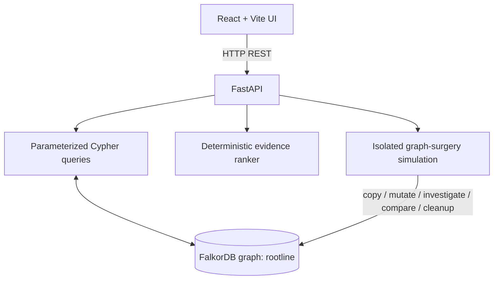
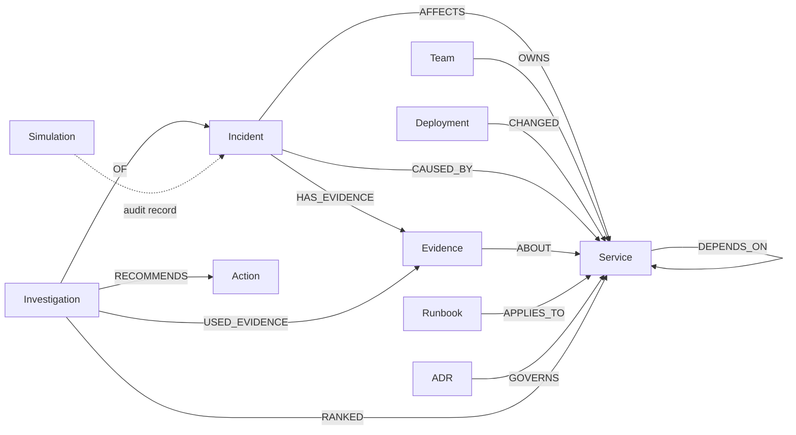

# Rootline Omni

**Counterfactual graph incident investigation, powered by FalkorDB.**

Rootline investigates synthetic service incidents by traversing dependency paths, weighing supporting and contradicting evidence, consulting incident history, calculating blast radius, and recording operator decisions. Its signature feature, **Live Graph Surgery**, removes selected dependency edges in an isolated graph copy and reruns the same investigation so the operator can compare what changed without intentionally changing baseline dependency topology.

> **Hackathon:** Graph Hacks 2026 · **Primary track:** Track 01 — Agents That Act on Connected Data. Persistent investigation decisions support the Track 02 memory theme, and graph-linked owners/runbooks/ADRs support the Track 03 Company Brain theme. Treat these as capability alignments, and select additional tracks only if the submission rules permit it and you can demonstrate them. The implementation is a rule-guided diagnostic workflow; it does not claim autonomous multi-agent coordination or an LLM planner.
>
> **Demo safety:** all incident and operational data are synthetic. Rootline does not connect to production telemetry, execute remediation, or replace human approval.

## Why FalkorDB is essential

The graph is part of the product's reasoning, not just a storage layer:

- Candidate causes are discovered through variable-length `DEPENDS_ON` traversal from the affected service.
- Blast radius is calculated by traversing the same edges in reverse dependency direction.
- Evidence, deployments, prior incident resolutions, ownership, runbooks, ADRs, and operator decisions are connected through graph relationships.
- Live Graph Surgery changes dependency topology in a temporary graph and compares a rerun against the baseline.

The backend uses parameterized Cypher for data values. The browser communicates with FastAPI; it never connects directly to FalkorDB.

## Features

- **Evidence-first ranking:** deterministic heuristic scores with a visible breakdown; scores are not probabilities.
- **Contradiction handling:** negative evidence can lower a candidate's score.
- **Uncertainty:** weak evidence can produce an `inconclusive` result instead of a forced root cause.
- **Live Graph Surgery:** remove one or more existing dependency edges from an isolated copy, rerun the investigation, compare paths and rankings, check baseline dependency topology, and report cleanup status.
- **Blast radius:** identify services that transitively depend on a selected service.
- **Company Brain:** resolve owning teams, synthetic runbook steps, and architecture decision records through graph relationships.
- **Investigation memory:** save investigations and operator decisions in FalkorDB and retrieve relevant prior decisions.
- **Trace and audit:** show sequential backend investigation stages and elapsed times; simulation audit records are stored in the baseline graph.
- **Human approval:** approve/reject a recommendation with a rationale. No remediation is executed.

## Architecture



Key files:

- `backend/main.py` — HTTP API and request validation
- `backend/queries.py` — graph reads/writes and parameterized Cypher
- `backend/investigator.py` — investigation stages and deterministic ranking
- `backend/agent.py` — bounded tool-calling agent with fail-closed Cypher policy
- `backend/algorithms.py` — native FalkorDB algorithms (PageRank, Betweenness, WCC)
- `backend/grounding.py` — anti-hallucination graph fact verification
- `backend/benchmark.py` — fair comparative evaluation suite (Graph-Native vs Keyword Baseline)
- `backend/surgery.py` — isolated graph-copy simulation, comparison, audit, cleanup
- `backend/seed.py` — idempotent synthetic demo graph
- `frontend/src/App.jsx` — 6-tab React UI command center
- `docs/FINAL_VERIFICATION_REPORT.md` — full release audit and verification report
- `docs/graph-model.md` — graph schema, queries, and score formula
- `docs/runbooks.md` — synthetic, read-only runbook content

## Graph model



See [`docs/graph-model.md`](docs/graph-model.md) for node properties, exact relationship directions, queries, and scoring. The graph model documentation is intended to match `backend/seed.py` and `backend/queries.py`.

## Local setup

### Prerequisites

- Python 3.10+ (use the version supported by your installed dependencies)
- Node.js and npm
- Docker Desktop, running

### 1. Start FalkorDB

PowerShell:

```powershell
docker run -d --name rootline-falkordb -p 6379:6379 -p 3000:3000 falkordb/falkordb:latest
```

If the container already exists, start it with `docker start rootline-falkordb`. To inspect it, use `docker logs rootline-falkordb`.

### 2. Install and seed the backend

From the repository's `rootline/` directory:

```powershell
python -m venv .venv
.\.venv\Scripts\Activate.ps1
# If script activation is blocked for this terminal only:
# Set-ExecutionPolicy -Scope Process Bypass
pip install -r requirements-dev.txt
Copy-Item .env.example .env
python -m backend.seed
uvicorn backend.main:app --reload --port 8000
```

### 3. Start the frontend

Open a second PowerShell terminal in `rootline/`:

```powershell
cd frontend
npm install
npm run dev
```

Open the Vite URL printed in the terminal (normally `http://localhost:5173`). The backend API is normally at `http://localhost:8000`; check `GET /api/health` to confirm the API and graph connection.

To build the frontend bundle, run `npm run build` from `frontend/`. The backend's production/static serving behavior depends on the built bundle being present; for development, use the separate Vite server above.

### 4. Run tests

From the repository root, with the virtual environment active:

```powershell
pytest -q
```

The tests use an isolated test graph. See [`docs/BUILD_STATUS.md`](docs/BUILD_STATUS.md) for the distinction between previously observed results and checks that still need to be rerun after the latest changes.

## Demo flow

1. Open `INC-2026-101` and inspect the affected service, candidate paths, evidence, contradiction, and score breakdown.
2. Open **Live Graph Surgery** and remove `inventory-service → cache-redis` in the simulation. Compare the rerouted path and resulting candidate ranking.
3. Confirm the response reports baseline dependency topology unchanged and whether temporary-graph cleanup succeeded. The simulation also writes an audit record to the baseline graph; therefore “unchanged” refers to dependency topology and investigation comparison, not a byte-for-byte unchanged graph.
4. Open the Company Brain context and read the synthetic runbook/ADR information in the app. No external placeholder URLs are used and no commands are executed.
5. Save an investigation decision with rationale, then inspect saved investigations / prior decisions.
6. Show the test output and explain the limits below.

Use only behaviors you have personally verified on the exact build and database configuration used for the recording. Graph Surgery requires graph-copy support from the configured FalkorDB server/client; unsupported environments should return an explicit error rather than silently creating an incomplete clone.

## ToG-inspired workbench and MCP-style tool adapter

The incremental ToG-inspired workbench is available in the UI's **ToG Workbench** tab. It reuses the existing tested investigator and fixed tool registry rather than introducing a second copy of the graph/query business logic.

### Endpoints added

- `POST /api/agent/tog` — accepts `prompt`, optional `incident_id`, bounded `max_steps` (1–8), and optional `request_surgery`. It resolves explicit service/incident identifiers against FalkorDB, executes a bounded policy based on actual prior observations, records measured timings, and validates the final candidate/path/evidence claim against graph records.
- `GET /api/mcp/tools` — returns schemas for the existing fixed tool registry.
- `POST /api/mcp/rpc` — a minimal JSON-RPC 2.0 adapter supporting `initialize`, `ping`, `tools/list`, and `tools/call` for the fixed tool registry.
- `GET /api/evaluation/ablation` — alias for the existing measured synthetic benchmark endpoint.

**Protocol scope:** the MCP endpoint is a prototype adapter, not a claim of full MCP transport/session conformance. It does not implement every deployment transport, session header, notification, pagination, or capability behavior required by a production MCP host. Do not describe this endpoint as fully compliant without testing against an official MCP client.

**Agent scope:** this code is a bounded deterministic observation-driven policy inspired by graph-exploration research. It is not an exact reimplementation of Think-on-Graph's LLM beam-search method, Reasoning on Graphs' planning/retrieval/reasoning framework, or an autonomous LLM planner. A tool may be called when its prerequisite observation exists; the trace contains the actual tool output and measured duration.

**Grounding:** claims are checked against live FalkorDB records. Unknown service-like tokens return `unknown_entity`; missing incident context returns `missing_data` instead of silently using a default incident. If grounding fails, the response returns `verification_failed`; it never forces the verification flag to true.

**Counterfactual wording:** Graph Surgery removes an existing directed dependency edge in an isolated graph copy, reruns the investigation, and compares observed results. This is a counterfactual topology experiment, not proof of real-world causality or a Pearl do-calculus identification result. Dependency-topology preservation and temporary graph cleanup are reported separately. A simulation audit record can be written to the baseline graph.

### Research references and what we borrow

- Sun et al., [Think-on-Graph: Deep and Responsible Reasoning of Large Language Model on Knowledge Graph](https://proceedings.iclr.cc/paper_files/paper/2024/hash/10a6bdcabbd5a3d36b760daa295f63c1-Abstract-Conference.html), ICLR 2024 — motivates iterative, graph-grounded exploration and traceable paths. ROOTLINE's current policy is inspired by this idea, not a faithful reproduction of the paper's LLM beam search.
- Luo et al., [Reasoning on Graphs: Faithful and Interpretable Large Language Model Reasoning](https://proceedings.iclr.cc/paper_files/paper/2024/hash/3e2aeb66481dd63a32421bf032b70384-Abstract-Conference.html), ICLR 2024 — motivates the separation of graph-grounded path retrieval and explanation. ROOTLINE does not implement RoG's learned relation-path planning.
- Wu et al., [MicroRCA: Root Cause Localization of Performance Issues in Microservices](https://doi.org/10.1109/NOMS47738.2020), NOMS 2020 — motivates graph-based reasoning about anomaly propagation in microservice environments. ROOTLINE uses synthetic data and hand-authored heuristic ranking; it does not reproduce MicroRCA's evaluation.
- [FalkorDB Python client](https://github.com/FalkorDB/falkordb-py) — documents the supported Python graph APIs, including parameterized `query`, read-only `ro_query`, and graph-copy methods.
- [Model Context Protocol specification, 2025-06-18](https://github.com/modelcontextprotocol/modelcontextprotocol/blob/main/docs/specification/2025-06-18/schema.mdx) — reference for JSON-RPC initialization and tool schema/call message shapes. ROOTLINE's adapter remains a limited prototype, not a complete host-transport implementation.

## API overview

- `GET /api/health`
- `GET /api/incidents`
- `GET /api/graph/overview`
- `POST /api/investigate/{incident_id}`
- `GET /api/investigations`
- `GET /api/investigations/{id}`
- `GET /api/graph/edges`
- `POST /api/simulate`
- `POST /api/investigations/{id}/decision`

For request schemas and response details, inspect the route definitions in `backend/main.py`. Invalid input should be rejected with a validation response; unknown resources, unavailable graph operations, and conflicts return explicit errors.

## Synthetic scenarios

- **`INC-2026-101`** — checkout HTTP 500s; Redis is a strong candidate, while a canary rollback provides contradicting evidence against the payment service.
- **`INC-2026-102`** — delayed order-confirmation emails; the message queue is a plausible cause.
- **`INC-2026-103`** — stale search results; deliberately designed to demonstrate an inconclusive outcome when evidence is insufficient.

These are fictional scenarios created for demonstration, not real production incidents or measured operational outcomes.

## Limitations and security

- All data, runbooks, ADRs, and incident history are synthetic.
- Ranking weights are hand-authored heuristics and are not calibrated probabilities.
- There is no live telemetry ingestion, authentication, production deployment integration, or automated remediation.
- The UI trace represents sequential backend stages, not independently acting autonomous agents.
- Graph Surgery supports dependency-edge counterfactuals only. It requires a supported graph-copy operation and must be verified on the target FalkorDB deployment.
- A simulation audit record is written to the baseline graph. The code checks dependency topology and rerun behavior, not byte-for-byte equality of the whole database.
- Do not put secrets in source control. Configure connection settings through `.env` and use a suitable secret manager outside local development.

## AI assistance disclosure

Complete this section truthfully for the submitted version. Name the AI tools actually used, what they helped with, what you personally implemented/reviewed, and which checks you ran yourself. Do not claim test results, live Docker compatibility, or functionality that you did not verify.

## Submission links

- Repository: _add your public repository URL_
- Demo video: _add your video URL_
- Live deployment: _not provided; use the local setup above_
