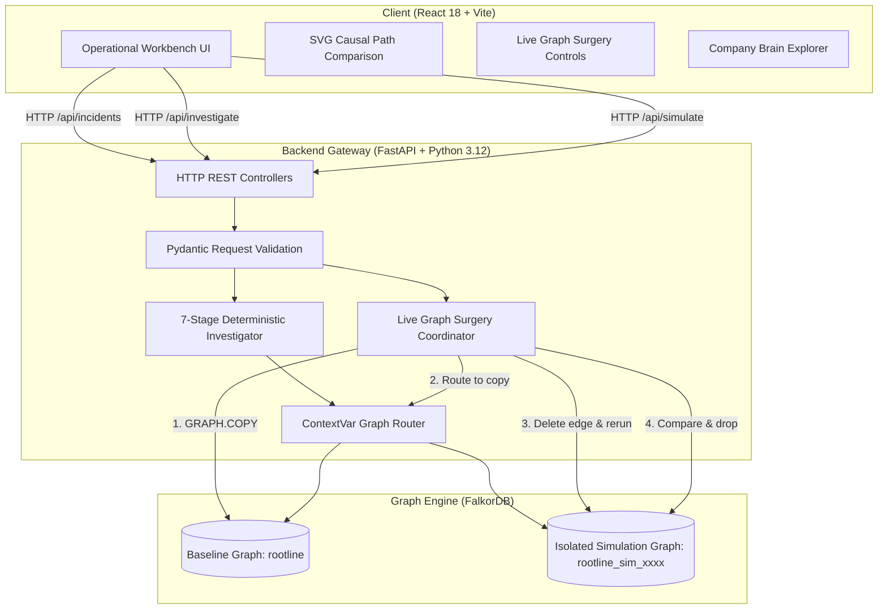

# ROOTLINE OMNI — Full-Stack Architecture Specification

## 1. System Overview

ROOTLINE OMNI is a graph-native incident investigation workbench built on top of FalkorDB. Rather than relying on static relational lookups or ungrounded generative AI text, ROOTLINE treats the software dependency topology as an active reasoning substrate.



---

## 2. Core Components

### 2.1 Frontend (`frontend/src/`)
- **React 18 + Vite 5**: High-craft single-page application.
- **Design Tokens**: Solid architectural neutrals (`#090e16` canvas, `#111a27` elevated surface, `rgba(113,145,183,0.2)` structural 1px borders), AAA text contrast, strict 4px/8px spacing grid.
- **SVG Causal Path Comparison (`CausalPathViz`)**: Real-time vector visualization comparing baseline dependency chains against counterfactual rerouted chains.
- **Live Graph Surgery Controls**: Preset selectors, edge dropdown, real-time safety grid verification badges.
- **Company Brain Explorer**: Direct graph access to Runbooks (`APPLIES_TO`), ADRs (`GOVERNS`), and Team Ownership (`OWNS`).
- **Legal & Privacy View**: Clean modal disclosure detailing synthetic data boundaries and zero-telemetry local operation.

### 2.2 Backend Gateway (`backend/main.py`)
- **FastAPI + Uvicorn**: High-performance asynchronous HTTP gateway.
- **Pydantic Validation**: Bounded payloads (`DecisionIn`, `EdgeIn`, `SimulateIn`) with min/max constraints, whitespace sanitization, and strict typing.
- **Error Mapping**: Converts graph connection failures (`GraphUnavailable`) to HTTP 503, invalid edge choices to HTTP 422, unknown entities to HTTP 404, and repeated decisions to HTTP 409 Conflict.
- **Static Asset Serving**: Automatically mounts `frontend/dist` at `/` for single-container or local monolithic execution.

### 2.3 Graph Data Access & Parameterized Cypher (`backend/queries.py`)
- Parameterized Cypher execution preventing injection attacks.
- Multi-hop variable-length path traversal (`[:DEPENDS_ON*1..4]`).
- Reverse-direction blast radius calculation.
- Historical incident matching via `CAUSED_BY`.
- Idempotent database seeding using Cypher `MERGE`.

### 2.4 Deterministic Ranking Engine (`backend/investigator.py`)
A transparent 7-stage diagnostic workflow:
1. `incident_context`: Resolves incident and entry affected service.
2. `dependency_traversal`: Traverses up to 4 hops in `DEPENDS_ON` direction.
3. `evidence_collection`: Queries deployments, historical incidents, and telemetry evidence.
4. `candidate_ranking`: Calculates deterministic heuristic scores (not probabilities).
5. `blast_radius`: Traverses reverse dependency direction.
6. `ownership_context`: Resolves owning teams, runbooks, and ADRs.
7. `memory_retrieval`: Queries prior approved/rejected operator decisions.

---

## 3. Live Graph Surgery: Technical Mechanics

Live Graph Surgery is ROOTLINE's signature differentiator. It provides mathematical counterfactual reasoning over connected systems.

### 3.1 Step-by-Step Lifecycle
1. **Baseline Evaluation**: The investigator runs against `rootline` (in memory) to establish baseline candidate scores, paths, and topology edge count ($N$).
2. **Pre-Allocation Validation**: Selected edges are validated against the baseline graph. Duplicates, self-referential loops (`a -> a`), and non-existent edges are rejected *before* any copy is created.
3. **True Isolation via `GRAPH.COPY`**: FalkorDB clones `rootline` to `rootline_sim_<uuid8>`. The existence of the clone is strictly verified.
4. **ContextVar Dynamic Routing**: Python's `contextvars.ContextVar` overrides the active graph target for the executing coroutine/thread to `rootline_sim_<uuid8>`.
5. **Targeted Mutation**: The selected edge is removed *only* inside `rootline_sim_<uuid8>` via `MATCH (a)-[r:DEPENDS_ON]->(b) DELETE r`.
6. **Counterfactual Rerun**: The exact same 7-stage investigation engine is executed inside the simulation graph.
7. **Safe Teardown (Finally Block)**: In all cases (success or unhandled failure), the simulation graph is deleted via `db.select_graph(sim_name).delete()`. Deletion is verified against `db.list_graphs()`.
8. **Invariance Verification**: The baseline graph `rootline` is re-inspected:
   - Baseline edge count must equal $N$.
   - Baseline edge list must match exactly.
   - Baseline investigation rerun must match baseline summary bit-for-bit.
9. **Simulation Audit Logging**: A non-invasive audit node `(:Simulation {id, incident_id, removed_edges, top_before, top_after, changed})` is recorded in the baseline graph.

---

## 4. Trust Boundaries & Security Model

```
[ Browser Client ]
       │
       │  Strict CORS: localhost:5173, 127.0.0.1:5173
       ▼
[ FastAPI Gateway ] ── (Pydantic Input Sanitization & Bounds)
       │
       │  Parameterized Cypher ($params) · Zero String Interpolation
       ▼
[ FalkorDB Engine ] ── (In-Memory Graph Store · Port 6379)
```

1. **No External Credentials**: Database credentials read via environment variables (`.env`).
2. **Zero Telemetry Leaks**: Application runs strictly locally; no third-party tracking, cookies, or remote analytics.
3. **No Automated Remediation**: ROOTLINE never executes destructive OS or shell commands. Recommendations require explicit human operator review and rationale.

---

## 5. Enterprise Production Scaling Blueprint

For multi-tenant cloud deployment beyond the local hackathon demo:
1. **L7 Load Balancing & Ingress**: Envoy / NGINX handling TLS 1.3 termination, HTTP/2 multiplexing, and WAF rate limiting.
2. **Stateless Backend Scaling**: FastAPI pods orchestrated via Kubernetes HPA scaling horizontally on CPU/memory thresholds.
3. **FalkorDB Cluster**: Primary-Replica cluster with Raft consensus providing high-availability read scaling and automated failover.
4. **Tenant Isolation**: Tenant sharding via dedicated graph namespaces (`tenant_abc_rootline`).
5. **Event Streaming**: Transactional outbox publishing operator decisions to Kafka / Redis Pub/Sub for enterprise SIEM integration.
