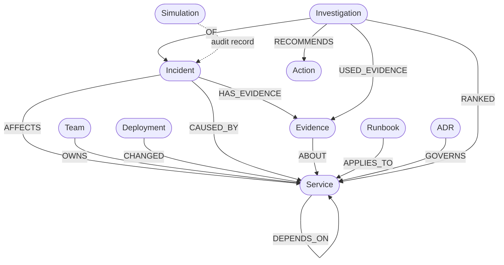

# ROOTLINE OMNI — Graph Data Model Specification

**Engine:** FalkorDB  
**Primary Graph Name:** `rootline`  
**Test Graph Name:** `rootline_test`  
**Simulation Graph Names:** `rootline_sim_<uuid8>`  
**Schema Definition Source:** `backend/seed.py` and `backend/queries.py`

---

## 1. Graph Conceptual Schema

---

## 2. Node Labels and Property Specifications

### 2.1 `Service`
Represents an internal microservice, database, cache, index, or message queue.
| Property | Type | Indexed | Description |
|---|---|---|---|
| `id` | `STRING` | YES | Unique canonical service identifier (e.g. `cache-redis`, `checkout-service`). |
| `name` | `STRING` | NO | Human-readable service title (e.g. `Redis Cache`). |
| `tier` | `INTEGER` | NO | Criticality tier (1 = most critical, 2 = secondary, 3 = auxiliary). |
| `kind` | `STRING` | NO | Service category: `service`, `database`, `cache`, `queue`, `index`. |

### 2.2 `Incident`
Represents a service disruption event.
| Property | Type | Indexed | Description |
|---|---|---|---|
| `id` | `STRING` | YES | Incident reference (e.g. `INC-2026-101`). |
| `title` | `STRING` | NO | Short summary description. |
| `severity` | `STRING` | NO | Priority level: `SEV1`, `SEV2`, `SEV3`. |
| `ts` | `INTEGER` | NO | Epoch timestamp (UTC seconds) of incident trigger. |
| `pattern` | `STRING` | NO | Diagnostic pattern: `latency_spike`, `queue_backlog`, `stale_data`, etc. |
| `status` | `STRING` | NO | Operational status: `open` or `resolved`. |
| `summary` | `STRING` | NO | Detailed diagnostic overview. |
| `resolution` | `STRING` | NO | Verified resolution notes (for resolved historical incidents). |
| `synthetic` | `BOOLEAN` | NO | Flag confirming fictional synthetic demo data (`true`). |

### 2.3 `Evidence`
Observable telemetry, logs, or canary verification results associated with an incident.
| Property | Type | Indexed | Description |
|---|---|---|---|
| `id` | `STRING` | YES | Evidence identifier (e.g. `EV-101-2`). |
| `kind` | `STRING` | NO | Evidence type: `metric`, `log`, `test`. |
| `polarity` | `STRING` | NO | Diagnostic impact: `supports`, `contradicts`, `symptom`. |
| `text` | `STRING` | NO | Factual observation text. |
| `ts` | `INTEGER` | NO | Observation timestamp in UTC epoch seconds. |
| `synthetic` | `BOOLEAN` | NO | Fictional demo data indicator (`true`). |

### 2.4 `Deployment`
A software release or configuration change modifying a service.
| Property | Type | Indexed | Description |
|---|---|---|---|
| `id` | `STRING` | YES | Deployment reference (e.g. `DEP-501`). |
| `version` | `STRING` | NO | Build or configuration version string. |
| `ts` | `INTEGER` | NO | Deployment timestamp in UTC epoch seconds. |
| `summary` | `STRING` | NO | Change log or release note summary. |

### 2.5 `Investigation`
A persisted record of an automated investigation and operator decision.
| Property | Type | Indexed | Description |
|---|---|---|---|
| `id` | `STRING` | YES | Unique investigation ID (e.g. `INV-A1B2C3D4`). |
| `created_at` | `INTEGER` | NO | Timestamp when investigation was conducted. |
| `incident_id` | `STRING` | NO | Target incident identifier. |
| `status` | `STRING` | NO | Conclusion status: `ranked` or `inconclusive`. |
| `top_candidate`| `STRING` | NO | Service ID of top-ranked candidate cause (or empty). |
| `decision` | `STRING` | NO | Human operator decision: `pending`, `approved`, `rejected`. |
| `rationale` | `STRING` | NO | Human operator explanation for approval or rejection. |
| `decided_at` | `INTEGER` | NO | Timestamp when human decision was recorded. |
| `report_json` | `STRING` | NO | Complete serialized JSON investigation report. |

### 2.6 `Runbook` (Company Brain)
Operational triage guidance linked to services.
| Property | Type | Indexed | Description |
|---|---|---|---|
| `id` | `STRING` | NO | Runbook code (e.g. `RB-cache-evictions`). |
| `title` | `STRING` | NO | Runbook title. |
| `uri` | `STRING` | NO | Internal documentation reference URI. |
| `steps` | `LIST[STRING]`| NO | Sequential operator checklist steps. |

### 2.7 `ADR` (Company Brain)
Architecture Decision Records governing service design constraints.
| Property | Type | Indexed | Description |
|---|---|---|---|
| `id` | `STRING` | NO | Architecture decision identifier (e.g. `ADR-007`). |
| `title` | `STRING` | NO | Decision title. |
| `decision` | `STRING` | NO | Accepted architectural policy statement. |

### 2.8 `Team` (Company Brain)
Service ownership organization.
| Property | Type | Indexed | Description |
|---|---|---|---|
| `id` | `STRING` | YES | Team code (e.g. `T-platform`, `T-payments`). |
| `name` | `STRING` | NO | Team display name. |

### 2.9 `Simulation` (Audit)
Record of a Live Graph Surgery experiment stored on the baseline graph.
| Property | Type | Indexed | Description |
|---|---|---|---|
| `id` | `STRING` | NO | Unique simulation identifier (e.g. `SIM-A1B2C3D4`). |
| `incident_id` | `STRING` | NO | Investigated incident. |
| `removed_edges`| `LIST[STRING]`| NO | Array of cut edge descriptions (e.g. `["inventory-service->cache-redis"]`). |
| `created_at` | `INTEGER` | NO | Simulation execution timestamp. |
| `top_before` | `STRING` | NO | Top candidate before edge removal. |
| `top_after` | `STRING` | NO | Top candidate after edge removal. |
| `changed` | `BOOLEAN` | NO | Whether the counterfactual changed the outcome. |

---

## 3. Relationships and Traversal Semantics

| Relationship | Direction | Meaning & Traversal Rule |
|---|---|---|
| `DEPENDS_ON` | `(a:Service)-[:DEPENDS_ON]->(b:Service)` | Service `a` calls or requires service `b`. Forward traversal (`*1..4`) discovers dependency causes. |
| `OWNS` | `(t:Team)-[:OWNS]->(s:Service)` | Team ownership of a microservice. |
| `CHANGED` | `(d:Deployment)-[:CHANGED]->(s:Service)` | Deployment applied changes to a service. Filtered by incident temporal window. |
| `AFFECTS` | `(i:Incident)-[:AFFECTS]->(s:Service)` | Entry service where symptoms were first detected. |
| `CAUSED_BY` | `(i:Incident)-[:CAUSED_BY]->(s:Service)` | Documented historical root cause of a resolved incident. |
| `HAS_EVIDENCE` | `(i:Incident)-[:HAS_EVIDENCE]->(e:Evidence)` | Evidence observation associated with an incident. |
| `ABOUT` | `(e:Evidence)-[:ABOUT]->(s:Service)` | Target service evaluated by an evidence item. |
| `APPLIES_TO` | `(r:Runbook)-[:APPLIES_TO]->(s:Service)` | Operator runbook relevant to a service. |
| `GOVERNS` | `(a:ADR)-[:GOVERNS]->(s:Service)` | Architecture decision governing service constraints. |
| `OF` | `(inv:Investigation)-[:OF]->(i:Incident)` | Linkage between investigation record and incident. |
| `RANKED` | `(inv:Investigation)-[:RANKED {rank, score}]->(s:Service)` | Persisted ranking position and score. |
| `USED_EVIDENCE`| `(inv:Investigation)-[:USED_EVIDENCE]->(e:Evidence)` | Evidence considered during ranking. |
| `RECOMMENDS` | `(inv:Investigation)-[:RECOMMENDS]->(act:Action)` | Proposed operator mitigation or verification action. |
