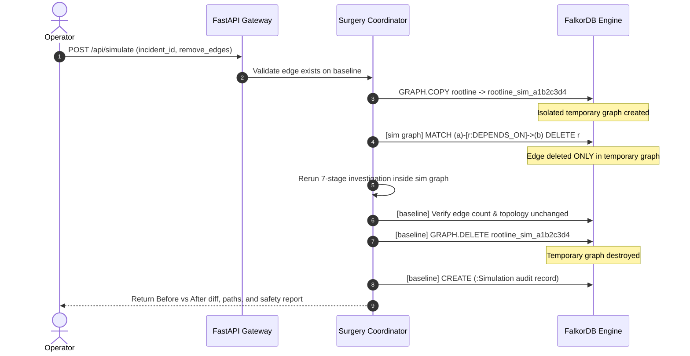

# Live Graph Surgery: Counterfactual Graph Incident Investigation

## 1. What is Live Graph Surgery?

In distributed systems incident analysis, correlation is often confused with causation. If service A and service B both degrade, does A cause B, does B cause A, or are both victims of a common dependency?

Traditional observability tools can only look backwards at recorded telemetry.  
**Live Graph Surgery** allows an engineer to conduct a **live counterfactual intervention** directly on the graph:

> *"If this dependency edge did not exist in the topology, would the incident path and root cause ranking change, remain identical, or become inconclusive?"*

---

## 2. The 5 Core Invariants of Live Graph Surgery

1. **Genuinely Isolated Topology**: The simulation runs in an independently addressed graph created via FalkorDB's native `GRAPH.COPY`. It is never a simulation on the live working graph.
2. **Baseline Topology Invariance**: The baseline graph `rootline` is inspected before and after. The edge count and exact edge sets must be identical.
3. **Deterministic Rerun**: The counterfactual run executes the exact same deterministic 7-stage investigation engine with the same heuristic weights and thresholds.
4. **Guaranteed Teardown**: The temporary graph is deleted in a Python `finally` block on both success and unexpected exceptions. If deletion fails, it is explicitly reported.
5. **Audit Transparency**: A non-invasive `(:Simulation)` node is appended to the baseline graph documenting who performed the experiment, what was cut, and what changed. "Unchanged" refers to dependency topology, not raw byte-level disk immutability.

---

## 3. Canonical Demonstration Scenarios

### Scenario A: The Key Counterfactual (Rerouting)
- **Incident**: `INC-2026-101` (Checkout HTTP 500s)
- **Cut Edge**: `inventory-service → cache-redis`
- **Result**:
  - Top candidate `cache-redis` was previously reached via `checkout-service → inventory-service → cache-redis`.
  - Cutting this edge forces the causal path to reroute via `checkout-service → payment-service → cache-redis`.
  - The before/after diff clearly highlights the altered dependency route in the vector SVG visualization.

### Scenario B: Negative Control (Unrelated Edge)
- **Incident**: `INC-2026-101` (Checkout HTTP 500s)
- **Cut Edge**: `search-service → search-index`
- **Result**:
  - `search-service` and `search-index` belong to the search subsystem and do not lie on the checkout path.
  - The simulation executes, removes the edge in the clone, and reruns the investigation.
  - **Outcome**: `changed: false`. Zero candidates change rank, score, or path.
  - Proves that ROOTLINE does not manufacture false positives.

### Scenario C: Complete Decoupling (Candidate Dropped)
- **Incident**: `INC-2026-101`
- **Cut Edges**: `inventory-service → cache-redis` AND `payment-service → cache-redis`
- **Result**:
  - All paths reaching `cache-redis` are severed.
  - `cache-redis` drops completely out of the candidate causes set.
  - The top candidate shifts to the next most likely culprit.

---

## 4. The 12 Verified Edge Case Tests (`tests/test_surgery.py`)

All 12 edge cases are automated and pass against the live FalkorDB instance:

1. `test_relevant_edge_removal_changes_results_and_baseline_is_restored`: Successful counterfactual investigation with rerouting.
2. `test_redundant_path_removal_does_not_change_ranking`: Removing one of two parallel paths keeps score stable.
3. `test_removing_both_cache_paths_drops_cache_from_candidates`: Severing all paths drops candidate.
4. `test_unrelated_edge_leaves_results_stable`: Negative control edge leaves results identical (`changed: false`).
5. `test_blast_radius_changes_when_upstream_edge_removed`: Verifies blast radius changes when upstream edge is pruned.
6. `test_unknown_edge_rejected_without_creating_simulation_graph`: Non-existent edges rejected with 422 before copy.
7. `test_selected_edge_missing_rejected`: Explicit missing edge test.
8. `test_self_referential_edge_rejected`: Rejects invalid `a -> a` self-loops.
9. `test_empty_edge_list_rejected`: Rejects empty surgery requests.
10. `test_graph_copy_failure_handled_safely`: Simulates graph copy failure; verifies clean exit and no dangling graphs.
11. `test_investigation_failure_during_simulation_cleans_up`: Simulates unhandled exception during rerun; verifies temporary graph deleted.
12. `test_repeated_and_concurrent_simulations_safety`: Consecutive and concurrent simulations use collision-resistant UUIDs.
