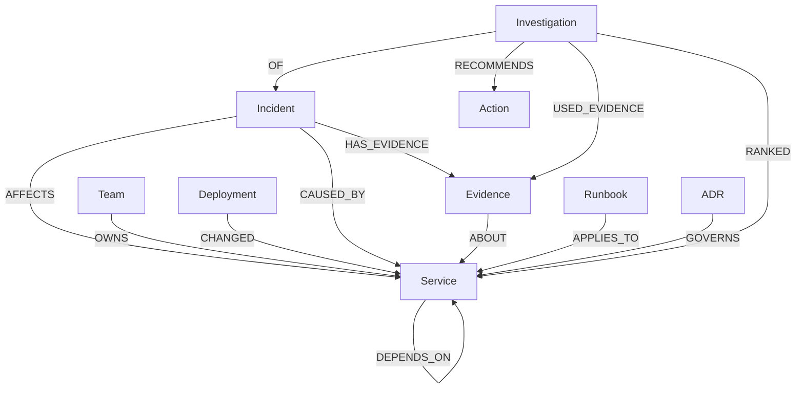

# Rootline Omni graph model

Database: FalkorDB · graph name: `rootline` · source of synthetic seed records: `backend/seed.py`.

All records are fictional. This document describes the labels and relationship directions used by the current seed/query implementation; it does not describe integrations with real systems.

## Node labels and principal properties

| Label | Principal properties |
|---|---|
| `Service` | `id`, `name`, `tier`, `kind` |
| `Team` | `id`, `name` |
| `Deployment` | `id`, `version`, `ts`, `summary` |
| `Incident` | `id`, `title`, `severity`, `ts`, `pattern`, `status`, `summary`, `resolution`, `synthetic` |
| `Evidence` | `id`, `kind`, `polarity`, `text`, `ts`, `synthetic` |
| `Investigation` | `id`, `created_at`, `incident_id`, `status`, `top_candidate`, `decision`, `rationale`, `decided_at`, `report_json` |
| `Runbook` | `id`, `title`, `uri`, `steps` (synthetic, read-only guidance) |
| `ADR` | `id`, `title`, `decision` |
| `Action` | `id`, `text`, `kind`, `requires_approval` |
| `Simulation` | `id`, `incident_id`, `removed_edges`, `created_at`, `top_before`, `top_after`, `changed` |

The seed attempts to create indexes on `id` for commonly queried labels. Existing-index errors are ignored to keep seeding repeatable.

## Relationship types and direction

| Relationship | Direction | Meaning |
|---|---|---|
| `DEPENDS_ON` | `(Service)-[:DEPENDS_ON]->(Service)` | A depends on B; direction is significant. |
| `OWNS` | `(Team)-[:OWNS]->(Service)` | Team ownership. |
| `CHANGED` | `(Deployment)-[:CHANGED]->(Service)` | Deployment changed a service. |
| `AFFECTS` | `(Incident)-[:AFFECTS]->(Service)` | Incident's affected/entry service. |
| `CAUSED_BY` | `(Incident)-[:CAUSED_BY]->(Service)` | Historical root-cause association for resolved incidents. |
| `HAS_EVIDENCE` | `(Incident)-[:HAS_EVIDENCE]->(Evidence)` | Evidence associated with an incident. |
| `ABOUT` | `(Evidence)-[:ABOUT]->(Service)` | Service discussed by an evidence record. |
| `APPLIES_TO` | `(Runbook)-[:APPLIES_TO]->(Service)` | Runbook applies to a service. |
| `GOVERNS` | `(ADR)-[:GOVERNS]->(Service)` | Architecture decision governs a service. |
| `OF` | `(Investigation)-[:OF]->(Incident)` | Investigation belongs to an incident. |
| `RANKED` | `(Investigation)-[:RANKED {rank, score}]->(Service)` | Candidate ranking and heuristic score. |
| `USED_EVIDENCE` | `(Investigation)-[:USED_EVIDENCE]->(Evidence)` | Evidence used by an investigation. |
| `RECOMMENDS` | `(Investigation)-[:RECOMMENDS]->(Action)` | Suggested action requiring human approval. |

A `Simulation` is currently stored as an audit node with properties; do not infer an unimplemented `SIMULATED_FOR` relationship.

## Core graph operations

1. **Incident entry:** match an `Incident` by ID and follow `AFFECTS` to its entry service.
2. **Candidate discovery:** traverse `DEPENDS_ON` from the entry service up to four hops. Each discovered service and path can contribute to ranking.
3. **Blast radius:** traverse incoming dependency paths by matching `(dependent)-[:DEPENDS_ON*1..4]->(target)`.
4. **Temporal evidence:** connect `Deployment` to `Service` with `CHANGED` and filter deployment timestamps against the incident window.
5. **Historical evidence:** find resolved incidents connected through `CAUSED_BY` to candidate services, excluding the current incident.
6. **Incident evidence:** follow `Incident-[:HAS_EVIDENCE]->Evidence-[:ABOUT]->Service`.
7. **Investigation persistence:** save `Investigation-[:OF]->Incident`, `RANKED`, `USED_EVIDENCE`, and `RECOMMENDS` relationships. Decisions are stored as properties on the `Investigation` node.
8. **Memory:** retrieve prior investigations whose `top_candidate` is in the current candidate set and whose decision is no longer `pending`.
9. **Company Brain:** retrieve `Runbook` and `ADR` records through `APPLIES_TO` and `GOVERNS`.
10. **Graph Surgery:** copy the graph, remove selected `DEPENDS_ON` edges only in the temporary copy, rerun the investigation, compare results, record a simulation audit node on the baseline, and clean up the temporary graph. If graph-copy support is unavailable, the operation must fail explicitly instead of substituting a partial seed.

The exact Cypher statements live in `backend/queries.py`; graph-copy orchestration lives in `backend/surgery.py`.

## Heuristic score

The current ranker uses a deterministic, hand-authored score that combines dependency distance, recency of deployment, historical incident matches, supporting evidence, and contradictions. It is a ranking heuristic, **not a probability**. The implementation in `backend/investigator.py` is authoritative; consult it before changing this document's formula or thresholds.

## Track alignment and limits

- **Track 01 — primary:** graph traversal, evidence-based candidate ranking, and counterfactual edge-removal simulations.
- **Track 02 — memory capability:** persisted investigation decisions can be retrieved on later runs. This is not a claim of multi-agent coordination.
- **Track 03 — Company Brain capability:** graph-linked team ownership, runbook guidance, and architecture decisions.

No LLM planner, autonomous multi-agent coordination, real telemetry integration, or production remediation is claimed by this implementation.
