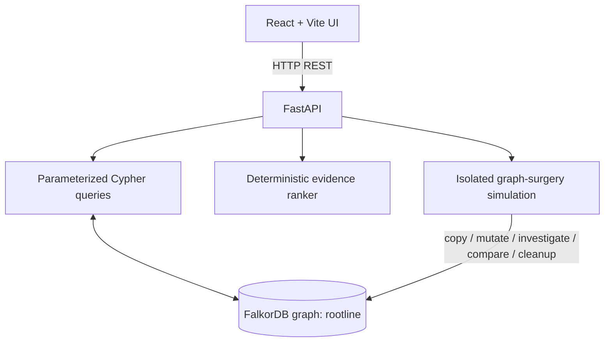

# ROOTLINE OMNI — Final Project Dossier

**Project:** ROOTLINE OMNI  
**Tagline:** Counterfactual Graph Incident Investigator & Company Brain  
**Core technology:** FalkorDB, Cypher, FastAPI, React, Vite  
**Event:** Graph Hacks 2026 — Context for AI Agents  
**Recommended primary track:** Track 01 — Agents That Act on Connected Data  
**Track 02 / Track 03:** Describe as capability alignments unless the official submission rules explicitly permit multiple track entries and the submitted build demonstrates them.

> **Status honesty:** This dossier describes the current polished project package. Python syntax compilation was previously checked. The full test suite, frontend production build, and live Docker/browser demo have not been re-run/verified in this environment after the latest edits. Do not claim those checks passed until you run them on the exact submission build.

## 1. Executive summary

ROOTLINE OMNI is a graph-native incident investigation prototype. It uses FalkorDB to represent service dependencies, incident symptoms, evidence, deployments, ownership, runbooks, architecture decisions, prior investigations, and operator decisions. The investigator traverses the graph, gathers connected evidence, computes deterministic heuristic scores, accounts for contradicting evidence, calculates blast radius, and can return an inconclusive result rather than forcing a root-cause guess.

Its main differentiator is **Live Graph Surgery**: the operator removes selected dependency edge(s) in an isolated graph copy, reruns the same investigation, and compares the resulting paths and rankings against the baseline. This is designed to show that the graph topology actively affects the answer—not merely the visualization. The simulation checks dependency topology and reports temporary graph cleanup; it also writes an audit record to the baseline graph, so “baseline unchanged” must not be described as byte-for-byte database immutability.

ROOTLINE OMNI is a prototype using synthetic demonstration data. It does not ingest production telemetry, execute remediation, or replace human approval.

## 2. Problem statement

During an incident, a visible symptom may occur in an edge service while a causal dependency sits several hops away. A recent deployment can be correlated with an incident without being the root cause. Contradictory evidence should reduce confidence, and incomplete evidence should lead to escalation or an inconclusive status rather than an unjustified answer.

A graph is appropriate because the system needs to reason over connected entities and paths: affected services, dependencies, evidence, deployments, historical resolutions, ownership, runbooks, and architecture decisions.

## 3. Target users and use case

**Target user:** an on-call engineer, SRE, or incident commander investigating a synthetic service outage.

**Primary workflow:**
1. Select an incident.
2. Inspect affected service and multi-hop dependency paths.
3. Review supporting and contradicting evidence.
4. Compare candidate causes and their score breakdowns.
5. Inspect reverse dependency blast radius.
6. Review owning team, runbook guidance, and relevant architecture decision.
7. Run Live Graph Surgery to test whether a dependency path is causally important.
8. Approve or reject a recommendation with a rationale.
9. Revisit stored investigation history and prior decisions.

## 4. Core capabilities

### 4.1 Graph-based candidate discovery
The investigator traverses `DEPENDS_ON` paths up to the configured depth from the affected service and returns candidate services with paths and hop distances.

### 4.2 Evidence-aware ranking
Candidates receive deterministic heuristic scores based on graph-connected evidence and related context. Contradictory evidence can penalize a candidate. Scores such as `11.3` and `6.15` are heuristic values, **not probabilities** and not measured production accuracy.

### 4.3 Inconclusive outcome
The system can return `inconclusive` when evidence does not meet its configured threshold or the evidence conflicts. This is a safety-oriented product behavior; it is not proof of a formally validated safety guarantee.

### 4.4 Blast-radius analysis
Reverse traversal of dependency relationships identifies services that depend on a candidate service, helping explain potential impact.

### 4.5 Company Brain
Graph-linked owner teams, synthetic runbook steps, and architecture decision records provide context for candidate services. Runbook content is displayed in the application and is not a live integration with internal company systems.

### 4.6 Persistent investigation memory
Investigations and operator decisions are stored in FalkorDB and can be retrieved as context for later investigations. This is graph-backed application memory, not a claim of model fine-tuning or universal memory.

### 4.7 Live Graph Surgery
The simulation:
1. validates requested dependency edges;
2. copies the graph into an isolated temporary graph, when the configured FalkorDB supports the required operation;
3. removes selected edge(s) in the temporary graph;
4. reruns the same investigation;
5. compares paths, rankings, and candidate outcomes;
6. checks baseline dependency topology;
7. cleans up the temporary graph and reports cleanup status;
8. records a simulation audit entry in the baseline graph.

If graph-copy support is unavailable, the system should fail explicitly rather than silently create an incomplete clone. Graph-copy compatibility must be tested on the actual server/client build used in the demo.

## 5. Why FalkorDB is essential

FalkorDB is part of the reasoning path:
- variable-length graph traversal discovers multi-hop candidates;
- dependency edges determine path reachability;
- reverse traversal computes blast radius;
- graph relationships connect evidence, deployments, ownership, runbooks, ADRs, and investigation memory;
- Live Graph Surgery alters dependency topology in an isolated graph and measures the effect on the investigation.

The browser talks to FastAPI over HTTP. It does not connect directly to FalkorDB.

## 6. Graph model

Use `docs/graph-model.md` and the actual source code as the authority for the exact model. The documented relationship directions in the polished project include:

- `(Incident)-[:AFFECTS]->(Service)`
- `(Service)-[:DEPENDS_ON]->(Service)`
- `(Team)-[:OWNS]->(Service)`
- `(Deployment)-[:CHANGED]->(Service)`
- `(Incident)-[:CAUSED_BY]->(Service)` for resolved incident knowledge
- `(Incident)-[:HAS_EVIDENCE]->(Evidence)`
- `(Evidence)-[:ABOUT]->(Service)`
- `(Runbook)-[:APPLIES_TO]->(Service)`
- `(ADR)-[:GOVERNS]->(Service)`
- investigation relationships connecting investigations to incidents, ranked services, evidence, and recommended actions
- simulation audit records associated with incidents

Before presenting any graph schema in the submission, verify the exact labels, properties, and relationship directions against `backend/seed.py` and `backend/queries.py`. Do not paste a stale schema from an earlier draft.

## 7. Architecture



### Main files
- `backend/main.py` — API routes and request validation
- `backend/queries.py` — parameterized Cypher reads and writes
- `backend/investigator.py` — investigation stages and deterministic scoring
- `backend/surgery.py` — graph copy, edge removal, rerun, comparison, audit, cleanup
- `backend/seed.py` — synthetic demo graph
- `backend/graph.py` — graph connection abstraction
- `frontend/src/App.jsx` — main React application
- `frontend/src/styles.css` — application styles
- `docs/graph-model.md` — schema, queries, and scoring details
- `docs/runbooks.md` — synthetic runbook material
- `tests/` — graph, API, investigator, and surgery tests

## 8. Technology stack

| Layer | Technology | Role |
|---|---|---|
| Graph database | FalkorDB | Connected operational graph and graph traversal |
| Query language | Cypher | Multi-hop paths, evidence/context lookups, and writes |
| Backend | Python + FastAPI | API, orchestration, validation, investigation logic |
| Frontend | React + Vite | Incident investigation and graph-surgery UI |
| Testing | pytest | Automated tests for graph, investigator, API, and simulation behavior |
| Local environment | Docker Desktop | Run FalkorDB locally |

Exact versions should be taken from the package files in the final repository. Do not state version numbers that are not pinned or verified.

## 9. API overview

The README lists these routes:
- `GET /api/health`
- `GET /api/incidents`
- `GET /api/graph/overview`
- `POST /api/investigate/{incident_id}`
- `GET /api/investigations`
- `GET /api/investigations/{id}`
- `GET /api/graph/edges`
- `POST /api/simulate`
- `POST /api/investigations/{id}/decision`

Use `backend/main.py` as the source of truth for request/response schemas. Confirm each endpoint against the running build before recording a demo.

## 10. Synthetic demo incidents

- **`INC-2026-101`** — checkout HTTP 500s; Redis is a strong candidate, while a canary rollback provides contradicting evidence against the payment service.
- **`INC-2026-102`** — delayed order-confirmation emails; the message queue is a plausible cause.
- **`INC-2026-103`** — stale search results; designed to demonstrate an inconclusive outcome when evidence is insufficient.

These are fictional scenarios for demonstration, not real incidents, live telemetry, or measured business outcomes.

## 11. Local setup (Windows PowerShell)

### Prerequisites
- Python version supported by the pinned dependencies
- Node.js and npm
- Docker Desktop running

### Start FalkorDB
```powershell
docker run -d --name rootline-falkordb -p 6379:6379 -p 3000:3000 falkordb/falkordb:latest
```

If the container already exists:
```powershell
docker start rootline-falkordb
docker logs rootline-falkordb
```

### Backend
Run from the `rootline/` project directory:
```powershell
python -m venv .venv
.\.venv\Scripts\Activate.ps1
pip install -r requirements-dev.txt
Copy-Item .env.example .env
python -m backend.seed
uvicorn backend.main:app --reload --port 8000
```

If PowerShell blocks activation in the current terminal, use:
```powershell
Set-ExecutionPolicy -Scope Process Bypass
```

### Frontend
Open a second terminal from `rootline/`:
```powershell
cd frontend
npm install
npm run dev
```

Open the URL printed by Vite, normally `http://localhost:5173`. Check the API at `http://localhost:8000/api/health`.

### Test and build
From the repository root with the virtual environment activated:
```powershell
pytest -q
```

From `rootline/frontend/`:
```powershell
npm run build
```

Run these checks on the exact final files before claiming success. The currently supplied build status documentation distinguishes previous results from checks still to rerun.

## 12. Final verification checklist

### Environment and startup
- [ ] Docker Desktop starts without errors.
- [ ] FalkorDB container is healthy and reachable on the configured port.
- [ ] Backend dependencies install from the repository requirements.
- [ ] Seeding completes and creates the expected synthetic graph.
- [ ] `GET /api/health` succeeds.
- [ ] Frontend installs, starts, and loads without console-breaking errors.

### Functional demo
- [ ] `INC-2026-101` loads and shows candidate paths, evidence, contradictions, and score breakdown.
- [ ] `INC-2026-103` demonstrates an inconclusive outcome.
- [ ] Company Brain shows owner/runbook/ADR context in-app.
- [ ] Approve/reject decision is saved and can be retrieved.
- [ ] Live Graph Surgery removes only requested existing dependency edges in the temporary graph.
- [ ] Positive control changes a relevant path/ranking as expected.
- [ ] Negative control on an unrelated edge leaves the expected investigation result stable.
- [ ] Temporary graph cleanup is confirmed.
- [ ] Baseline dependency topology is checked.
- [ ] Audit-record side effect is disclosed accurately.
- [ ] `pytest -q` passes on the exact final build.
- [ ] `npm run build` succeeds on the exact final build.

## 13. Known limitations and risk controls

- All included data is synthetic.
- Scores are manually designed heuristics, not probabilities or trained-model confidence.
- No live production telemetry ingestion is included.
- No production remediation is executed.
- Human approval remains part of the workflow.
- The trace shows sequential backend stages; do not call it independent autonomous multi-agent coordination.
- Graph Surgery depends on graph-copy support and must be tested against the target FalkorDB build.
- The baseline graph receives a simulation audit record; “unchanged” means dependency topology/investigation comparison is preserved as checked, not byte-for-byte database equality.
- Authentication, production deployment integrations, and enterprise secret management are outside this local prototype.
- Never commit credentials or real incident data.

## 14. Agent and track positioning

**Recommended primary track:** Track 01 — Agents That Act on Connected Data.

Describe the current build as a **rule-guided graph diagnostic workflow**. It conditionally evaluates evidence and uncertainty through deterministic backend logic. Do not claim a dynamic autonomous planner or LLM agent unless the code actually selects and invokes tools based on runtime graph results.

Track 02 can be described as a memory-related capability because investigations and decisions persist in the graph. Track 03 can be described as a Company Brain capability because owner teams, runbooks, and ADRs are graph-linked. Enter additional tracks only after confirming the official rules allow it and you can demonstrate each track's requirements.

## 15. Suggested 2:45–3:00 demo script

**0:00–0:20 — Problem and thesis**  
“Rootline investigates incident causes through connected service dependencies, evidence, ownership, and historical decisions. FalkorDB is doing the reasoning, not just drawing the graph.”

**0:20–0:55 — Investigation**  
Open `INC-2026-101`. Show the affected service, multi-hop paths, candidate ranking, supporting/contradicting evidence, and explain that scores are deterministic heuristics.

**0:55–1:35 — Live Graph Surgery**  
Choose a meaningful edge such as `inventory-service → cache-redis`. Run the simulation. Show before/after paths and candidate ranking. Explain that the simulation uses an isolated graph copy and checks baseline dependency topology and cleanup.

**1:35–2:00 — Negative control and uncertainty**  
If verified, remove an unrelated edge and show that the result remains stable. Open `INC-2026-103` to demonstrate an inconclusive outcome instead of a forced guess.

**2:00–2:25 — Company Brain and memory**  
Show owner, synthetic runbook/ADR context, then save and retrieve an operator decision.

**2:25–2:50 — Technical proof and limits**  
Show actual test output from the final build. Mention synthetic data, no automated remediation, and the graph-copy compatibility requirement. Do not show a test result that was not freshly run.

## 16. Submission checklist

- [ ] Public GitHub repository URL added to README.
- [ ] README has exact setup instructions and correct graph model.
- [ ] No `.invalid` URLs are presented as live integrations.
- [ ] AI-assistance disclosure is accurate for tools and work actually used.
- [ ] Fresh backend tests and frontend build results captured.
- [ ] Demo video recorded from the exact submitted build.
- [ ] Video link added to README and submission form.
- [ ] Live deployment link provided only if a working deployment actually exists.
- [ ] Primary track and any additional tracks checked against official rules.
- [ ] No secrets or real/private incident information committed.
- [ ] Participant can explain every key module, graph query, score, and simulation limitation.

## 17. Recommended file formats and deliverables

| Deliverable | Format | Purpose |
|---|---|---|
| Runnable project | `.zip` | Source code, tests, docs, package files |
| GitHub documentation | `README.md` | Main judge-facing project explanation |
| Detailed project dossier | `.md`, `.docx`, `.pdf` | Full project narrative, architecture, verification, demo plan |
| Architecture diagram | Mermaid in `.md` | Versionable, editable source diagram |
| Demo video | `.mp4` or platform URL | Evidence of the actual running application |
| Test evidence | terminal screenshot or text log | Evidence from the exact final build |
| Submission links | URLs in README/form | Public repository and video; deployment only if live |

The Markdown version is best for GitHub and source control. DOCX is best for editing/review. PDF is best for sharing a stable, readable dossier. The ZIP is the runnable code package and should not be treated as proof that the application has been executed successfully.

## 18. Final project pitch

ROOTLINE OMNI is a FalkorDB-powered incident investigation prototype that follows dependency paths, weighs connected evidence and contradictions, calculates blast radius, surfaces ownership and operational knowledge, and stores operator decisions. Its defining feature, Live Graph Surgery, tests how removing dependency edges changes an investigation in an isolated graph copy. This makes graph structure part of the reasoning process and gives engineers a concrete counterfactual tool for inspecting candidate causes—while preserving human approval and clearly communicating uncertainty.

**Final status:** polished submission candidate; final local tests, frontend build, and live demo must be re-run and confirmed before making those verification claims.
