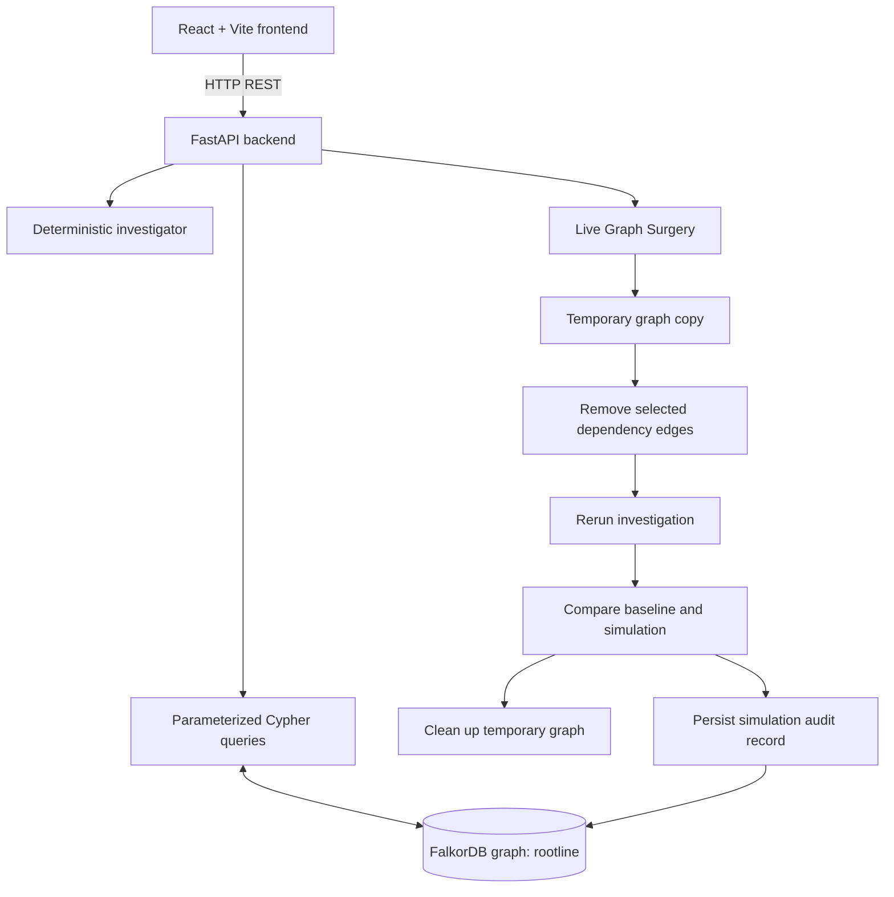

# ROOTLINE OMNI — Full Project Guide
## Architecture, features, setup, testing, troubleshooting, and hackathon walkthrough

**Project:** ROOTLINE OMNI  
**Positioning:** Counterfactual graph incident investigation powered by FalkorDB  
**Primary hackathon track:** Track 01 — Agents That Act on Connected Data  
**Repository archive covered:** `ROOTLINE_OMNI_FINAL.zip`  
**Guide purpose:** Explain what the project is, how its components fit together, how to run it, how to test the critical workflow, and how to prepare a truthful submission.

> **Verification note:** This guide describes the contents and setup documented in the supplied project ZIP. It does not claim that Docker, a specific FalkorDB server/client combination, every browser workflow, public hosting, or hackathon submission has been independently verified. The project’s own review documentation flags those as checks to perform in the target environment.

---

## 1. Executive summary

ROOTLINE OMNI is a graph-native incident investigation prototype. It helps an engineer explore a synthetic service incident by following dependency relationships in FalkorDB, gathering connected evidence, ranking possible causes with a deterministic heuristic, examining the blast radius, consulting linked ownership/runbook/architecture-decision information, and saving an operator decision.

Its signature capability is **Live Graph Surgery**. The operator selects dependency edges to remove in a temporary graph copy. ROOTLINE reruns the same investigation against that isolated copy and compares the result with the baseline. The intent is to ask a counterfactual question such as: *“If this dependency were not present, would the investigation path or candidate ranking change?”*

This is a decision-support prototype, not an automated production incident-response system. The incident records, runbooks, ADRs, and historical context are synthetic. It does not ingest live production telemetry or execute remediation.

### What it is designed to demonstrate
- FalkorDB is used for meaningful graph traversals and connected-data reasoning.
- Investigation findings are explainable through paths, evidence, and a score breakdown.
- Negative or contradictory evidence can affect a candidate ranking.
- The system can report inconclusive results rather than always forcing a root cause.
- A counterfactual dependency intervention can be compared with the baseline.
- Saved investigations and operator decisions can provide persistent history.
- Team ownership, runbooks, and ADRs are connected through graph relationships.

### What it does not claim
- Calibrated causal probabilities.
- Live observability or production telemetry integrations.
- Autonomous remediation.
- Independently acting autonomous agents or an LLM planner.
- Byte-for-byte immutability of the entire baseline graph during simulation: the simulation writes an audit record to the baseline graph. The intended safety guarantee concerns baseline dependency topology and the investigation comparison.
- Compatibility with every FalkorDB server/client deployment. Graph-copy support must be tested in the exact environment.

---

## 2. Problem and solution

### The problem
During a service incident, an engineer often needs to connect several kinds of information:
- the service affected by the incident;
- downstream or upstream dependencies;
- deployments near the incident time;
- evidence that supports or contradicts a candidate cause;
- similar historical incidents;
- owning teams and operational guidance;
- decisions already made during earlier investigations.

A flat list of services or a static dashboard may show individual records but does not naturally represent multi-hop dependency paths or allow a dependency change to be evaluated against the same investigation logic.

### ROOTLINE’s approach
ROOTLINE represents services, incidents, evidence, deployments, teams, runbooks, architecture decisions, investigations, actions, and simulations as graph data. Backend queries traverse relationships in FalkorDB. A deterministic investigator combines the retrieved evidence into ranked candidates. Live Graph Surgery creates a temporary graph copy, changes selected dependency edges there, reruns the investigation, and compares outcomes.

### Example question
“If `checkout-service` is failing, which connected services are plausible causes, what evidence supports or contradicts them, and would the diagnosis change if a particular dependency edge were absent?”

The system supports investigation and human decision-making. It does not automatically restart services, roll back deployments, or execute runbook commands.

---

## 3. Architecture overview



### Main components

| Component | File | Responsibility |
|---|---|---|
| HTTP API | `backend/main.py` | FastAPI routes, request validation, and API orchestration |
| Query/data layer | `backend/queries.py` | FalkorDB queries and graph reads/writes |
| Investigation engine | `backend/investigator.py` | Investigation stages, evidence handling, deterministic ranking, and report assembly |
| Surgery engine | `backend/surgery.py` | Isolated graph-copy simulation, edge removal, rerun, comparison, audit, and cleanup |
| Demo graph seeding | `backend/seed.py` | Creates the synthetic graph and makes setup repeatable |
| Graph connection | `backend/graph.py` | FalkorDB connection and graph access |
| User interface | `frontend/src/App.jsx` | Main React workflow and user interactions |
| Styling | `frontend/src/styles.css` | Visual layout and styling |
| React entry | `frontend/src/main.jsx` | Frontend application bootstrap |
| Vite config | `frontend/vite.config.js` | Frontend development/build configuration |
| Graph documentation | `docs/graph-model.md` | Node labels, relationships, graph operations, and scoring notes |
| Runbook content | `docs/runbooks.md` | Synthetic read-only runbook guidance |
| Final review | `docs/FINAL_REVIEW.md` | Design choices and known verification gaps |
| Build status | `docs/BUILD_STATUS.md` | Test/build status and what still needs verification |

### Request flow
1. A user selects an incident in the frontend.
2. The frontend sends an HTTP request to FastAPI.
3. The backend validates the request and invokes the investigation logic.
4. The query layer retrieves graph relationships and evidence from FalkorDB.
5. The investigator assembles a deterministic report and ranking.
6. The frontend displays findings, graph paths, evidence, trace stages, and available actions.
7. If the user runs surgery, the backend copies the graph (subject to server/client support), removes selected edges in the copy, reruns the investigation, compares results, and attempts cleanup.
8. The simulation audit record is written to the baseline graph.
9. If the operator saves a decision, the investigation/decision is persisted and can be retrieved through the history endpoints.

The browser should communicate with FastAPI, not connect directly to FalkorDB.

---

## 4. Graph data model

The documented graph name is `rootline`. The seed source is `backend/seed.py`. All supplied scenario data is synthetic.

### Node labels

| Label | Principal properties | Purpose |
|---|---|---|
| `Service` | `id`, `name`, `tier`, `kind` | Application or infrastructure service |
| `Team` | `id`, `name` | Owning team |
| `Deployment` | `id`, `version`, `ts`, `summary` | Synthetic change/deployment event |
| `Incident` | `id`, `title`, `severity`, `ts`, `pattern`, `status`, `summary`, `resolution`, `synthetic` | Incident record |
| `Evidence` | `id`, `kind`, `polarity`, `text`, `ts`, `synthetic` | Supporting or contradicting information |
| `Investigation` | `id`, `created_at`, `incident_id`, `status`, `top_candidate`, `decision`, `rationale`, `decided_at`, `report_json` | Investigation and saved decision |
| `Runbook` | `id`, `title`, `uri`, `steps` | Synthetic, read-only operational guidance |
| `ADR` | `id`, `title`, `decision` | Architecture decision record |
| `Action` | `id`, `text`, `kind`, `requires_approval` | Suggested action, not automatically executed |
| `Simulation` | `id`, `incident_id`, `removed_edges`, `created_at`, `top_before`, `top_after`, `changed` | Simulation audit record |

### Relationship types and direction

| Relationship | Direction | Meaning |
|---|---|---|
| `DEPENDS_ON` | `(Service)-[:DEPENDS_ON]->(Service)` | A service depends on another service; direction matters |
| `OWNS` | `(Team)-[:OWNS]->(Service)` | Team ownership |
| `CHANGED` | `(Deployment)-[:CHANGED]->(Service)` | Deployment changed a service |
| `AFFECTS` | `(Incident)-[:AFFECTS]->(Service)` | Service associated with the incident |
| `CAUSED_BY` | `(Incident)-[:CAUSED_BY]->(Service)` | Historical root-cause association |
| `HAS_EVIDENCE` | `(Incident)-[:HAS_EVIDENCE]->(Evidence)` | Evidence attached to an incident |
| `ABOUT` | `(Evidence)-[:ABOUT]->(Service)` | Service discussed by evidence |
| `APPLIES_TO` | `(Runbook)-[:APPLIES_TO]->(Service)` | Runbook applies to a service |
| `GOVERNS` | `(ADR)-[:GOVERNS]->(Service)` | ADR governs a service |
| `OF` | `(Investigation)-[:OF]->(Incident)` | Investigation belongs to an incident |
| `RANKED` | `(Investigation)-[:RANKED {rank, score}]->(Service)` | Candidate rank and heuristic score |
| `USED_EVIDENCE` | `(Investigation)-[:USED_EVIDENCE]->(Evidence)` | Evidence used by an investigation |
| `RECOMMENDS` | `(Investigation)-[:RECOMMENDS]->(Action)` | Suggested action requiring human approval |

A `Simulation` is documented as an audit node with properties. Do not assume a `SIMULATED_FOR` relationship exists unless the actual code adds it.

### Important graph direction concept
If `A -[:DEPENDS_ON]-> B`, then A depends on B. For blast-radius analysis, the relevant question is often which other services transitively depend on B. That requires traversing dependency edges in the reverse conceptual direction from the target service, while preserving the stored edge direction in the query.

### Core graph operations
1. Find the incident and follow `AFFECTS` to its affected/entry service.
2. Traverse `DEPENDS_ON` up to the implementation’s configured depth to discover candidate services and paths.
3. Calculate blast radius by finding dependent services along incoming dependency paths.
4. Connect deployments to changed services and consider timestamps relative to the incident.
5. Find historical incidents associated with candidate services through `CAUSED_BY`.
6. Follow `HAS_EVIDENCE` and `ABOUT` to associate evidence with services.
7. Persist investigations through `OF`, `RANKED`, `USED_EVIDENCE`, and `RECOMMENDS` relationships.
8. Retrieve prior investigations whose candidates overlap the current candidate set and whose decisions are no longer pending.
9. Resolve runbooks and ADRs through `APPLIES_TO` and `GOVERNS`.
10. Copy the graph for surgery, remove selected dependency edges in the copy, rerun the investigation, compare results, audit the simulation, and clean up the copy.

The exact query strings are in `backend/queries.py`. Treat that file as the authoritative implementation.

---

## 5. Investigation engine and scoring

The investigator is in `backend/investigator.py`. It is a deterministic, rule-guided backend workflow, not an LLM planner or autonomous multi-agent system.

The documented ranking considers factors including:
- dependency distance/path;
- deployment recency;
- historical incident matches;
- supporting evidence;
- contradictory or negative evidence.

The precise weights, formulas, thresholds, and stage sequence must be read from the actual `backend/investigator.py` implementation. Do not invent or manually change the formula based only on this summary.

### Why contradiction handling matters
Evidence that argues against a candidate should be visible and may reduce its score. This makes the output more explainable than a system that only accumulates positive signals.

### Why an inconclusive outcome matters
Not every incident has enough evidence to justify a root-cause recommendation. The seeded `INC-2026-103` scenario is intended to show that insufficient evidence can result in an inconclusive finding.

### Score interpretation
Scores are hand-authored heuristics. A score is not a calibrated probability that a service caused an incident. Present score breakdowns as relative ranking evidence only.

### Investigation trace
The interface can display sequential backend stages, operations, elapsed times, and result details. This is a trace of one deterministic workflow; it does not prove independently acting agents, parallel autonomous reasoning, or an LLM-driven planner.

---

## 6. Live Graph Surgery: detailed workflow

This is the signature feature and the most important part to test before recording a demo.

### Intended sequence
1. Run the baseline investigation against the original graph.
2. Capture baseline dependency topology and investigation output.
3. Select one or more existing `DEPENDS_ON` edges.
4. Request the simulation through the API.
5. The surgery layer creates an isolated temporary graph copy using the supported graph-copy mechanism.
6. It removes the selected edges only from that temporary graph.
7. It reruns the same investigation against the copy.
8. It compares candidate rankings and paths with the baseline.
9. It checks whether baseline dependency topology remains unchanged.
10. It writes a `Simulation` audit record to the baseline graph.
11. It cleans up the temporary graph.
12. It returns the comparison and separate status fields to the UI.

### Safety semantics
“Baseline unchanged” refers to the baseline dependency topology and investigation comparison. The baseline graph does receive a simulation audit record, so it is not byte-for-byte identical after a successful simulation.

### Critical compatibility requirement
Graph-copy commands and behavior may vary by FalkorDB server/client version and deployment mode. If the operation is unsupported, the implementation is intended to return an explicit service-unavailable error rather than create a partial graph by reseeding. A partial copy could omit saved investigations, decisions, audit records, or other state and invalidate the comparison.

### How to test surgery
1. Start FalkorDB and seed the graph.
2. Open the application and investigate `INC-2026-101`.
3. Record the baseline candidate/path shown by the UI.
4. Open Live Graph Surgery.
5. Remove the documented relevant edge `inventory-service → cache-redis` in the simulation.
6. Run the simulation and inspect the actual response.
7. Confirm that the response distinguishes the investigation change, baseline topology status, temporary graph cleanup, and audit persistence.
8. Inspect the baseline graph or rerun the baseline investigation to confirm dependency topology is intact.
9. Run the unrelated-edge scenario only if that edge exists in the current seeded graph; do not fabricate an edge.
10. If the operation fails due to graph-copy compatibility, record it as a blocker and do not claim surgery passed.

### What counts as success
- The intervention uses a real temporary graph or verified isolation method.
- The selected edge is removed in that isolated graph.
- The same investigation logic is rerun.
- Results are derived from the modified graph.
- The original dependency topology remains unchanged.
- Cleanup is attempted and its status is visible.
- Errors are explicit and do not masquerade as successful simulations.

---

## 7. Company Brain, runbooks, ADRs, and memory

### Company Brain
ROOTLINE links teams, services, runbooks, and ADRs through graph relationships:
- `Team -[:OWNS]-> Service`
- `Runbook -[:APPLIES_TO]-> Service`
- `ADR -[:GOVERNS]-> Service`

The runbook guidance is synthetic and read-only. Opening it should display guidance; it should not execute commands. ADRs are also intended to open in the UI.

### Investigation memory
Saved investigations and decisions are persisted in FalkorDB. The application can retrieve earlier investigation context when it matches the current candidate set and has a decision state other than pending, as described in the graph-model documentation.

### Persistence check
1. Run an investigation.
2. Save a decision with a rationale.
3. Confirm the UI reports the save succeeded.
4. Reload the page.
5. Open investigation history or saved investigations.
6. Verify that the record and decision still appear.
7. Restart the backend and repeat the retrieval if the environment allows it.

Do not claim memory is persistent if the result disappears after reload or restart in a way inconsistent with the documented behavior.

---

## 8. Synthetic scenarios

The README documents these fictional scenarios:

| Incident | Intended demonstration |
|---|---|
| `INC-2026-101` | Checkout HTTP 500s; Redis is a strong candidate, while a canary rollback supplies contradicting evidence against the payment service |
| `INC-2026-102` | Delayed order-confirmation emails; the message queue is a plausible cause |
| `INC-2026-103` | Stale search results; evidence is intentionally insufficient to demonstrate an inconclusive result |

These are fictional examples. Do not present them as real incidents, real customer data, measured production outcomes, or validated causal diagnoses.

---

## 9. API overview

The README lists the following routes:

| Method | Route | Purpose |
|---|---|---|
| `GET` | `/api/health` | API and graph connection health check |
| `GET` | `/api/incidents` | List available incidents |
| `GET` | `/api/graph/overview` | Graph overview |
| `POST` | `/api/investigate/{incident_id}` | Run an investigation |
| `GET` | `/api/investigations` | List saved investigations |
| `GET` | `/api/investigations/{id}` | Retrieve one investigation |
| `GET` | `/api/graph/edges` | Retrieve graph edges |
| `POST` | `/api/simulate` | Run a counterfactual graph simulation |
| `POST` | `/api/investigations/{id}/decision` | Record a decision for an investigation |

Use the route definitions and Pydantic request models in `backend/main.py` as the authoritative source for payloads, field names, response schemas, and status codes. Do not guess request JSON from route names.

### Health-check procedure
After the backend starts, open `http://localhost:8000/api/health` in a browser or use PowerShell:

```powershell
Invoke-RestMethod http://localhost:8000/api/health
```

Inspect the returned response. A running HTTP server alone is not proof that FalkorDB is reachable.

---

## 10. Windows PowerShell setup, step by step

These commands follow the repository README. Execute them from the extracted project directory.

### Step 1 — Extract the project
1. Download `ROOTLINE_OMNI_FINAL.zip`.
2. Extract it to a simple path, for example `C:\Projects\ROOTLINE_OMNI`.
3. Open the extracted `rootline` folder in VS Code.
4. Open the integrated PowerShell terminal.
5. Confirm that the current directory contains `requirements.txt`, `backend`, `frontend`, and `README.md`:

```powershell
Get-ChildItem
```

### Step 2 — Check prerequisites
Run:

```powershell
python --version
node --version
npm --version
docker --version
docker info
```

Expected: Python is available, Node.js/npm are available, and Docker Desktop is running. The README specifies Python 3.10+ with the version supported by the installed dependencies.

If a command is missing, install the corresponding runtime before continuing. If `docker info` fails, start Docker Desktop and retry.

### Step 3 — Start FalkorDB
Start a local container:

```powershell
docker run -d --name rootline-falkordb -p 6379:6379 -p 3000:3000 falkordb/falkordb:latest
```

If the container already exists:

```powershell
docker start rootline-falkordb
```

Check status and logs:

```powershell
docker ps
docker logs --tail 50 rootline-falkordb
```

If the name is already in use by a stopped container, use `docker start rootline-falkordb`; do not create a second container with the same name.

The `latest` tag can change over time. For a reproducible final demo, record the exact image/version used after verifying it. Do not claim all versions support graph-copy behavior.

### Step 4 — Create and activate a Python virtual environment
From the `rootline` project root:

```powershell
python -m venv .venv
.\.venv\Scripts\Activate.ps1
```

If PowerShell blocks script activation in this terminal:

```powershell
Set-ExecutionPolicy -Scope Process Bypass
.\.venv\Scripts\Activate.ps1
```

This changes policy only for the current PowerShell process.

### Step 5 — Install backend dependencies
With the virtual environment active:

```powershell
python -m pip install --upgrade pip
pip install -r requirements-dev.txt
```

The development requirements include the runtime requirements plus pytest and httpx. The runtime requirements include FastAPI, Uvicorn, FalkorDB's Python client, and Pydantic.

### Step 6 — Create local environment configuration
Copy the example:

```powershell
Copy-Item .env.example .env
```

The documented variables are:

```dotenv
FALKORDB_HOST=localhost
FALKORDB_PORT=6379
FALKORDB_PASSWORD=
ROOTLINE_GRAPH=rootline
```

The example contains placeholders only. Use a real password only if your chosen server requires it, and never commit secrets. Confirm that the code reads these settings as expected.

### Step 7 — Seed the synthetic graph
From the project root, with the virtual environment active:

```powershell
python -m backend.seed
```

Inspect the terminal for errors. If seeding fails, verify Docker status, host/port/password settings, and the actual connection code in `backend/graph.py`.

### Step 8 — Start the backend
In the same terminal:

```powershell
uvicorn backend.main:app --reload --port 8000
```

Leave this terminal running.

Check the health endpoint in a second terminal:

```powershell
Invoke-RestMethod http://localhost:8000/api/health
```

Do not proceed until the response indicates the API and graph connection are healthy.

### Step 9 — Install frontend dependencies
Open a second PowerShell terminal. Change into the extracted `rootline` folder if necessary, then:

```powershell
cd frontend
npm install
```

The repository includes `package-lock.json`; retain it so dependency resolution remains reproducible.

### Step 10 — Start the frontend
From `rootline\frontend`:

```powershell
npm run dev
```

Open the exact URL printed by Vite, usually:

`http://localhost:5173`

Keep both backend and frontend terminals running.

### Step 11 — Build the frontend for production
In the frontend directory:

```powershell
npm run build
```

The command should finish successfully and generate the Vite production bundle. This verifies compilation, not every browser interaction or backend integration.

### Step 12 — Run tests
Stop neither server unless the test instructions require it. Open another terminal at the `rootline` project root, activate `.venv`, and run:

```powershell
python -m pytest -q
```

Capture the real terminal output. If the suite fails, preserve the complete error and diagnose the first relevant failure rather than claiming success from an earlier run.

### Step 13 — Exercise the complete UI
1. Open the Vite URL.
2. Select `INC-2026-101`.
3. Run the investigation.
4. Inspect the evidence, paths, candidate ranking, contradiction, and trace.
5. Open Live Graph Surgery.
6. Select a real dependency edge shown by the application.
7. Run the simulation.
8. Inspect the baseline and simulated result.
9. Check topology-preservation and cleanup status.
10. Open the Company Brain/runbook and ADR views.
11. Save a decision with a rationale.
12. Reload the page and inspect saved history.

If any of these steps cannot be completed, write down the exact action, error message, and environment. Do not call the workflow fully verified.

---

## 11. Test and release checklist

Run this checklist against the exact build and database you intend to demonstrate.

### Backend and database
- [ ] Docker/FalkorDB container is running.
- [ ] API health endpoint responds.
- [ ] Graph seed command completes.
- [ ] Incidents are returned from the graph.
- [ ] Investigation results use actual graph queries.
- [ ] Saved investigations can be retrieved.
- [ ] Decision persistence survives page reload.
- [ ] Invalid incident IDs and malformed inputs return clear errors.
- [ ] Database failure is handled explicitly.

### Live Graph Surgery
- [ ] Graph-copy operation works on the target server/client.
- [ ] Baseline investigation is recorded.
- [ ] A real existing dependency edge is removed only in the temporary copy.
- [ ] Investigation reruns against the copy.
- [ ] Comparison results are derived from real output.
- [ ] Baseline dependency topology remains unchanged.
- [ ] Temporary graph cleanup succeeds, or failure is explicitly reported.
- [ ] Audit persistence status is visible.
- [ ] Unsupported graph-copy behavior returns an explicit error.
- [ ] Relevant-edge and unrelated-edge scenarios are tested where the fixture supports them.

### Frontend
- [ ] Vite development server starts.
- [ ] Main incident selection works.
- [ ] Investigation request succeeds.
- [ ] Evidence and score breakdown render.
- [ ] Graph Surgery request and comparison render.
- [ ] Runbook and ADR views open.
- [ ] Decision can be saved and retrieved.
- [ ] No blocking browser console errors.
- [ ] No clipped primary controls at demo resolution.
- [ ] Production build succeeds.

### Release artifacts
- [ ] README setup commands were tested.
- [ ] Graph model and real Cypher/query documentation are included.
- [ ] AI disclosure is truthful.
- [ ] No secrets are committed.
- [ ] Test report records actual results and environment.
- [ ] Public GitHub URL is verified.
- [ ] Demo video URL is verified.
- [ ] Submission track is correct.
- [ ] Hackathon portal confirms successful submission.

---

## 12. Troubleshooting

### Docker command fails
- Start Docker Desktop.
- Run `docker info`.
- Check whether the named container already exists with `docker ps -a`.
- Use `docker start rootline-falkordb` if it exists.
- Inspect `docker logs --tail 100 rootline-falkordb`.

Do not delete containers or volumes without understanding whether they contain state you need.

### Backend cannot connect to FalkorDB
- Confirm the container is running.
- Confirm port `6379` is published.
- Check `.env` host, port, password, and graph name.
- Compare the settings with `backend/graph.py`.
- Re-run the health endpoint.
- Inspect the full backend traceback.

### `pip install` fails
- Verify `python --version`.
- Ensure the virtual environment is active.
- Retry using `python -m pip install -r requirements-dev.txt`.
- Save the exact package/error output. Do not silently remove a required dependency to bypass the error.

### PowerShell activation is blocked
Use `Set-ExecutionPolicy -Scope Process Bypass` for the current terminal, then activate the virtual environment again.

### Frontend fails to start
- Confirm the current directory is `rootline/frontend`.
- Run `npm install`.
- Check the Node/npm versions.
- Read the first error in the terminal.
- Confirm the backend is running on the URL expected by the frontend.
- Check browser devtools for failed HTTP requests.

### Graph Surgery returns an unsupported-operation error
This can indicate that graph-copy functionality is not available in the target FalkorDB server/client combination. Record the exact version and traceback. Do not claim surgery works in that environment, and do not replace a full copy with an incomplete reseeded graph unless a correct, tested isolation design is implemented.

### Tests fail
- Capture the full output.
- Separate environment/setup failures from assertion failures.
- Fix the earliest reproducible root cause.
- Rerun the specific failing test and then the full suite.
- Update `docs/BUILD_STATUS.md` and `docs/TEST_REPORT.md` only with actual results.

### Decision does not persist
- Inspect the decision API response.
- Inspect backend logs and graph write errors.
- Verify the investigation ID exists.
- Reload and query saved investigations.
- Do not label the feature persistent until retrieval confirms it.

---

## 13. Security and limitations

The project is a demo prototype and should not be treated as a production incident-response service.

Known limitations documented by the project:
- All incidents, runbooks, ADRs, and historical data are synthetic.
- Scores use hand-authored heuristics and are not calibrated probabilities.
- There is no live telemetry ingestion.
- There is no authentication in the documented prototype.
- No production deployment integration or automated remediation is provided.
- The trace is a sequence of backend stages, not autonomous agents.
- Graph Surgery supports dependency-edge counterfactuals and depends on compatible graph-copy support.
- A simulation audit record is written to the baseline graph.
- Compatibility with the exact Docker or cloud server used for a demo must be checked.

Security basics:
- Never commit `.env` with secrets.
- Keep `.env.example` to placeholders.
- Do not add real incident or customer data.
- Do not expose FalkorDB directly to the public internet for a demo.
- Do not execute runbook commands automatically.
- Keep human approval explicit.

---

## 14. Hackathon positioning and presentation

### Recommended primary track
**Track 01 — Agents That Act on Connected Data.**

The strongest evidence for this positioning is the actual graph-based investigation and counterfactual dependency intervention. Track 02 memory and Track 03 Company Brain can be described as additional capabilities, but select multiple tracks only if the rules permit it and you can demonstrate each capability.

Avoid claiming:
- autonomous multi-agent coordination;
- an LLM planner;
- live production telemetry;
- automated remediation;
- real incident data;
- a causal probability model.

### Suggested 2:45 demo structure
| Time | Show | Narration goal |
|---|---|---|
| 0:00–0:20 | Incident and problem | Explain why dependencies and connected evidence matter |
| 0:20–0:55 | Baseline investigation | Show graph-derived paths, evidence, contradiction, and ranking |
| 0:55–1:40 | Live Graph Surgery | Remove an existing edge in isolation and compare results |
| 1:40–2:00 | Negative control, if verified | Show a valid unrelated-edge test without forcing a result |
| 2:00–2:25 | Runbook/ADR and saved decision | Show connected operational context and human decision history |
| 2:25–2:45 | Test evidence and limitations | Prove what was tested and state the prototype boundary |

Record only after the exact demo environment passes the checks. Keep the browser at a readable resolution, close unrelated tabs, and avoid editing code during the recording unless the event specifically requests it.

### Judge-facing explanation
“ROOTLINE OMNI uses FalkorDB as the reasoning substrate for incident investigation. It traverses dependency paths, links evidence and operational context, ranks candidates with an explainable deterministic heuristic, and lets an operator test a dependency-edge counterfactual in an isolated graph copy. It compares the result with the baseline and records the operator’s decision. The data is synthetic, and the system is decision support—not production remediation.”

---

## 15. Public repository and submission steps

1. Run the tests and production build from the final project.
2. Check `git status` and review all files before committing.
3. Ensure `.env`, credentials, virtual environments, `node_modules`, caches, and local generated artifacts are excluded.
4. Confirm the README accurately describes current functionality and setup.
5. Create or select the intended public GitHub repository.
6. Inspect any existing Git history/remotes before initializing or changing them.
7. Commit the reviewed source and documentation.
8. Push only to the intended repository after verifying the remote URL.
9. Open the public repository in a private/incognito browser window to confirm access.
10. Record the demo against the exact verified build.
11. Upload the video and verify the URL opens.
12. Read the current official event requirements again.
13. Complete the event form with the real repository/video links and truthful track/AI disclosure.
14. Confirm the portal reports successful submission.

Do not assume the final ZIP itself proves that a public repo exists, a video is uploaded, or a submission has been accepted.

---

## 16. Current known verification status

The included `docs/BUILD_STATUS.md` and `docs/FINAL_REVIEW.md` are the project-specific source of truth for the status recorded when the archive was prepared. The project history includes a report of 32 passing tests and a successful frontend build on an embedded FalkorDB environment, but those results should be rerun on the final extracted ZIP and the actual demo environment.

The final review documentation explicitly identifies Docker FalkorDB compatibility, graph-copy support in the chosen server/client, and full browser interaction as checks that require verification. Public repository, video upload, and submission status also require separate confirmation.

When updating the status, distinguish:
- **Passed:** command was actually run and passed in the stated environment.
- **Failed:** command was actually run and failed.
- **Not run:** no result exists.
- **Blocked:** attempted but prevented by a specific environmental issue.
- **Reported by user:** result supplied by the user but not independently reproduced in the current environment.

Never merge these categories into one “all tests passed” statement.

---

## 17. Quick command reference

From `rootline/`:

```powershell
# Create and activate virtual environment
python -m venv .venv
.\.venv\Scripts\Activate.ps1

# Install backend development dependencies
pip install -r requirements-dev.txt

# Create local environment file
Copy-Item .env.example .env

# Seed graph
python -m backend.seed

# Start backend
uvicorn backend.main:app --reload --port 8000

# Run tests (in a separate terminal at rootline/)
python -m pytest -q
```

From `rootline/frontend/`:

```powershell
npm install
npm run dev
npm run build
```

Docker:

```powershell
docker run -d --name rootline-falkordb -p 6379:6379 -p 3000:3000 falkordb/falkordb:latest
docker ps
docker logs --tail 50 rootline-falkordb
```

Health check:

```powershell
Invoke-RestMethod http://localhost:8000/api/health
```

---

## 18. Final definition of a ready submission

ROOTLINE OMNI is ready to submit only when:
- the app starts from a clean extraction using documented commands;
- FalkorDB performs the actual graph work;
- the baseline investigation works;
- Live Graph Surgery is verified on the exact target environment;
- baseline dependency topology remains intact;
- temporary graph cleanup and audit status are reported;
- saved decisions and Company Brain views work as described;
- tests and production build are rerun and their output is recorded;
- README and documentation are complete and truthful;
- no secrets are included;
- the public repository and demo video are verified;
- the submission form is completed and confirmation is visible.

**Priority:** fix real blockers, verify the core workflow, document actual evidence, package cleanly, and submit with time remaining. Avoid last-minute feature expansion that risks breaking the working build.
